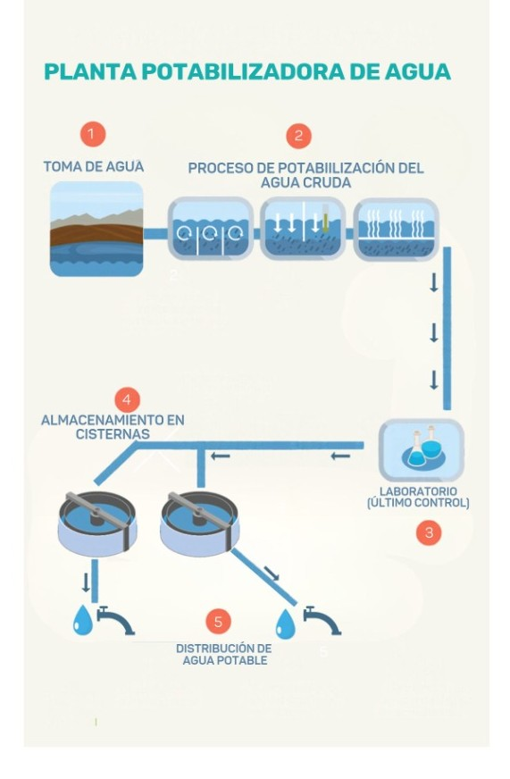
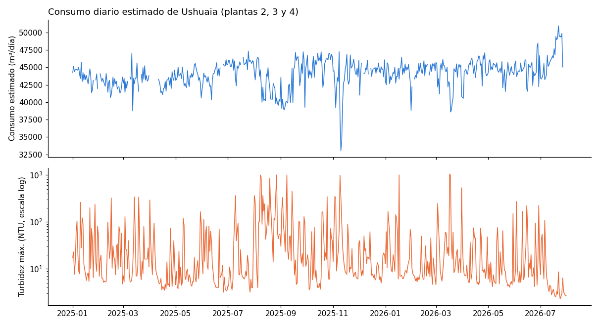
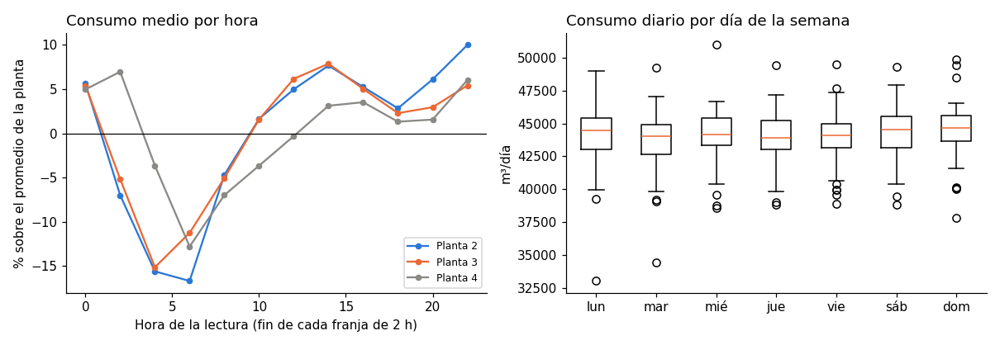
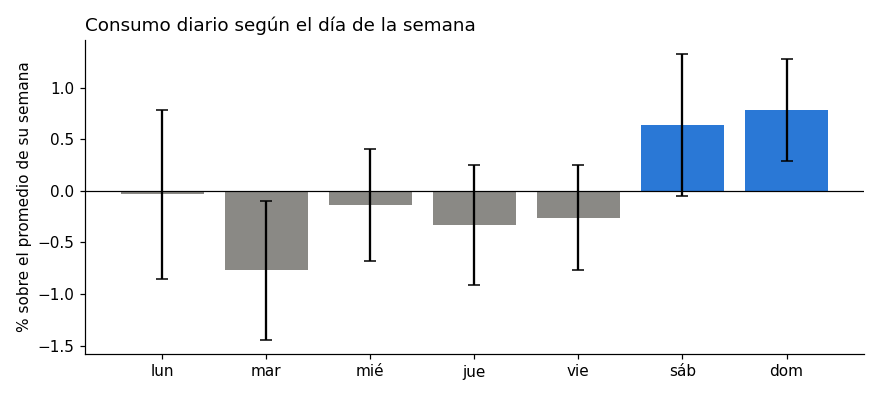
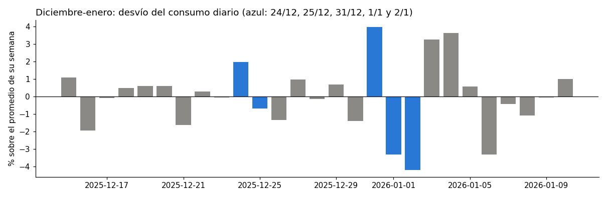
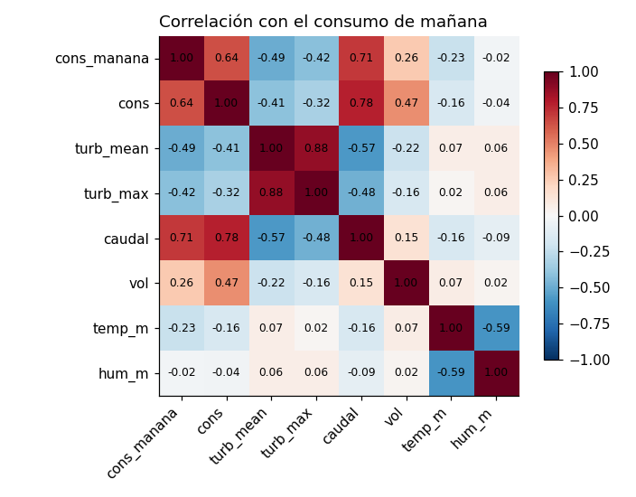
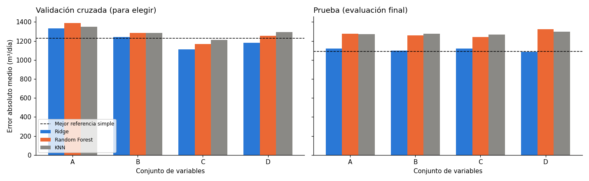
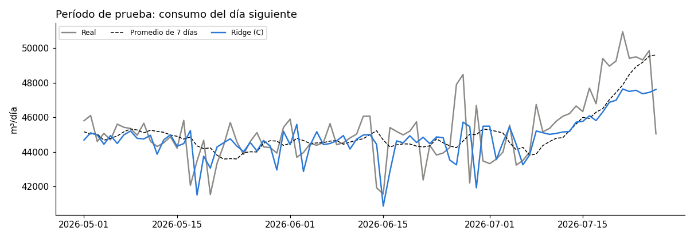
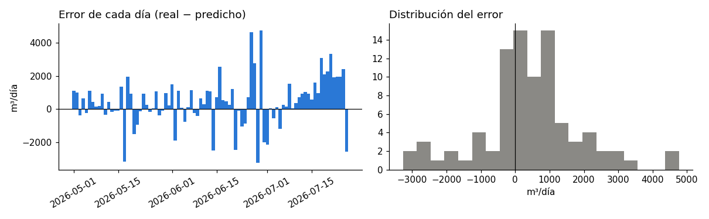
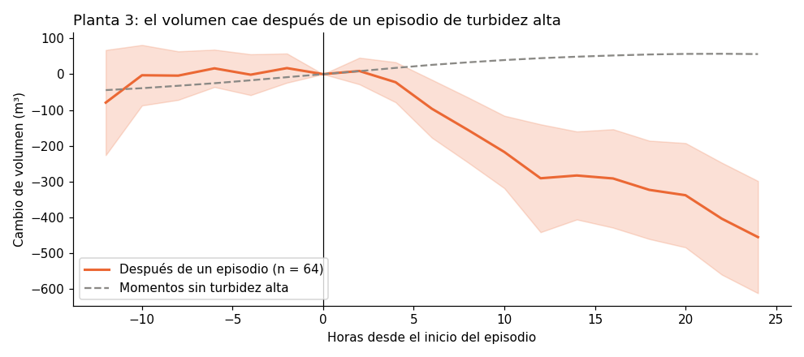

# ¿Cuánta agua va a consumir Ushuaia mañana?

**Predicción del consumo diario de agua potable con aprendizaje automático**

**Alumna:** Tamara Roa · **Curso:** Aprendizaje Automático · **Tecnicatura en Ciencia de Datos e IA** — Centro Politécnico Superior Malvinas Argentinas · **2026**

**Video (7 min):** [\[Video explicativo\]](https://drive.google.com/file/d/183zkLtPc8Kj0szCyjNBgboiLMohBFL97/view?usp=drive_link) · **Notebook:** [`notebooks/Consumo_agua_Ushuaia.ipynb`](https://colab.research.google.com/drive/1US_C95F5MSJxeTH-Yyj-UujsIEiynoyf)

---

## El proyecto en números

| 💧 ≈ 44.000 m³ | consumo diario de la ciudad (estimado) |
| :---- | :---- |
| 🏭 **3 plantas** | abastecen Ushuaia: la 2, la 3 y la 4 |
| 📅 **19 meses** | de telemetría, con una lectura cada 2 horas |
| 📊 **502 días** | con datos completos: 414 para entrenar y 87 para la prueba (el 30/04 queda afuera) |
| 🎯 **2,5 %** | error medio del modelo elegido |
| ⚖️ **0** | modelos que le ganan con claridad a una regla simple: y eso también es un resultado |

---

## Índice

1. [El problema](#1-el-problema)  
2. [Cómo llega el agua a las casas](#2-cómo-llega-el-agua-a-las-casas)  
3. [Objetivos](#3-objetivos)  
4. [Los datos](#4-los-datos)  
5. [Estimación del consumo por balance](#5-estimación-del-consumo-por-balance)  
6. [Qué muestran los datos](#6-qué-muestran-los-datos)  
7. [Los modelos](#7-los-modelos)  
8. [Resultados](#8-resultados)  
9. [¿Dónde se equivoca el modelo?](#9-dónde-se-equivoca-el-modelo)  
10. [Análisis complementario: la turbidez y las reservas de la Planta 3](#10-análisis-complementario-la-turbidez-y-las-reservas-de-la-planta-3)  
11. [Conclusiones](#11-conclusiones)  
12. [Limitaciones y trabajo futuro](#12-limitaciones-y-trabajo-futuro)  
13. [Referencias](#13-referencias)

---

## 1. El problema

Ushuaia consume cerca de 44.000 m³ de agua potable por día, pero **no hay una medición directa de cuánto consume la ciudad en total**: hay medidores en algunos usuarios, no en todos. Lo que sí se mide, cada 2 horas, es cuánta agua entra a cada planta potabilizadora y cuánta hay guardada en sus cisternas.

Si se puede anticipar el consumo de mañana, es más fácil planificar la producción, el mantenimiento y los cortes de cada planta.

> **La pregunta:** con lo que se sabe al terminar el día, ¿se puede predecir cuánta agua va a consumir la ciudad al día siguiente?

| Tipo de problema | Supervisado — regresión |
| :---- | :---- |
| **Unidad de observación** | Un día de la ciudad (plantas 2, 3 y 4\) |
| **Momento de predicción** | Al cierre de cada día |
| **Horizonte** | 24 horas |
| **Qué se predice** | El consumo del día siguiente, en m³ |

---

## 2. Cómo llega el agua a las casas




*Esquema del proceso de potabilización.&nbsp;*

El recorrido tiene cinco pasos: **(1)** se toma agua cruda de un arroyo o río; **(2)** se potabiliza; **(3)** el laboratorio hace el último control; **(4)** se guarda en cisternas; y **(5)** se distribuye a la red.

Mis datos miden dos puntos de ese recorrido: el **agua cruda que entra** (paso 1: caudal y turbidez) y el **volumen de las cisternas** (paso 4). Con esos dos puntos estimó el consumo, como explico en la sección 5\.

### Las plantas de Ushuaia

Según la Dirección Provincial de Obras y Servicios Sanitarios (DPOSS), hoy potabilizan tres plantas. La Planta 1 dejó de potabilizar: ahora bombea agua ya potable hacia la cisterna Las Terrazas.

| Planta | Fuente de agua | Capacidad (DPOSS) | Ingreso medio en mis datos\* | Parte del consumo de la ciudad |
| :---- | :---- | :---- | :---- | :---- |
| **Nº 2 "Buena Esperanza"** | Arroyo Buena Esperanza y arroyo Grande | 305 L/s | ≈ 308 L/s | 60 % |
| **Nº 3 "Gran Malvina"** | Arroyo Grande | 125 L/s de diseño \+ 50 de ampliación | ≈ 131 L/s | 26 % |
| **Nº 4 "Malvinas Argentinas"** (2017) | Río Pipo | 100 L/s | ≈ 71 L/s | 14 % |

*\* Cálculo propio: consumo medio diario de cada planta convertido a L/s (m³/día ÷ 86,4).*

> **Dato que surge del cruce:** la Planta 2 trabaja prácticamente al límite de su capacidad, y DPOSS informa que está trabajando para que la Planta 4 asuma parte de su zona de servicio. Sumando las tres plantas, la capacidad nominal es de 530 L/s, unos **45.800 m³/día**. En el período de prueba (mayo a julio de 2026), la ciudad consumió en promedio **45.237 m³/día**, el 99 % de esa capacidad. En invierno, el sistema trabaja cerca de su techo.

---

## 3. Objetivos

**General:** estimar el consumo diario de agua de Ushuaia y predecir el del día siguiente con modelos de regresión.

**Específicos:**

1. Estimar el consumo diario por balance entre el agua que entra y la variación de las cisternas.  
2. Explorar los datos: ritmos diarios y semanales, feriados, turbidez, caudal y clima.  
3. Comparar tres modelos (Ridge, Random Forest y KNN) con tres reglas simples.  
4. Evaluar con MAE, RMSE y R², y analizar dónde se equivoca el modelo.  
5. Como complemento, analizar qué pasa con las reservas de la Planta 3 después de un episodio de turbidez alta.

---

## 4. Los datos

|  | Telemetría de las plantas | Clima |
| :---- | :---- | :---- |
| **Fuente** | DPOSS (Tierra del Fuego) | Servicio Meteorológico Nacional, estación Ushuaia Aero |
| **Qué mide** | Turbidez del agua cruda (NTU), caudal de ingreso (L/s) y nivel de cisternas | Temperatura y humedad |
| **Frecuencia** | Una lectura cada 2 horas | Horaria |
| **Período** | 01/01/2025 a 31/07/2026 | 01/01/2025 a 06/11/2026 |
| **Registros** | 6.924 a 7.296 por planta | 16.055 |

&nbsp;

### Preprocesamiento

| Paso | Qué hice | Por qué |
| :---- | :---- | :---- |
| Hora | Pasé de hora universal a hora de Ushuaia | Para que el "día" sea el día real de la ciudad |
| Caudal anómalo | Lo marqué y lo dejé sin dato | Ceros o valores imposibles, por ejemplo 510 L/s en la Planta 3 |
| Turbidez de 999 NTU | La conservé | Es el tope del sensor: el agua estaba igual o más turbia. Son los episodios más fuertes |
| Faltantes | No completé nada: los días incompletos quedan fuera | Inventar datos podía distorsionar el consumo |
| Nivel de cisternas | De % a m³, con la capacidad de cada cisterna | Para poder sumar las cisternas de cada planta |

---

## 5. Estimación del consumo por balance

Dado que no existe una medición directa del consumo total de la ciudad, se lo estima mediante un balance de agua en cada planta. El razonamiento es simple: si se conoce el volumen de agua que ingresa y la variación del volumen almacenado en las cisternas, la diferencia corresponde al agua que salió hacia la red.

**Consumo del día \= agua que ingresó a la planta − variación del volumen de las cisternas**

La validez de esta estimación se apoya en el perfil horario obtenido: presenta un mínimo durante la madrugada y un máximo entre la tarde y la noche, que es el comportamiento esperable del consumo de una ciudad (ver sección 6).

&nbsp;*Limitación:* se trata de una estimación y no de una medición directa. El valor obtenido incluye las pérdidas del proceso de potabilización y de la red de distribución, así como los usos que no pasan por un medidor.

&nbsp;

---

## 6. Qué muestran los datos

### Un consumo muy estable



En el 90 % de los días el consumo está entre 40.000 y 47.000 m³, con una variación típica de solo el **4,5 %**.

### Un ritmo diario de ciudad



En las plantas 2 y 3 el consumo sigue el ritmo típico de una ciudad: baja de madrugada y sube de la tarde a la noche.

La Planta 4 se comporta distinto: de noche su consumo se mantiene alto. Tiene una explicación operativa. Es la planta más nueva (2017) y su sistema automatizado aprovecha las horas en que la ciudad consume menos para lavar los filtros, lo que además ayuda a alargar su vida útil. Como el balance no separa el agua que se usa en ese lavado del agua que sale a la red, el lavado aparece en los datos como consumo nocturno.

### El calendario casi no lo cambia



El día de la semana y los feriados mueven el consumo **menos de un 1 %**. Las fiestas de fin de año muestran un patrón, pero con un solo año de datos.



### ¿Qué se relaciona con el consumo de mañana?



| Variable de hoy | Relación con el consumo de mañana |
| :---- | :---- |
| Caudal de ingreso | **0,71** (fuerte) |
| Consumo de hoy | **0,64** (fuerte) |
| Turbidez media | **−0,49** (inversa) |
| Volumen almacenado | 0,26 (débil) |
| Temperatura | −0,23 (débil) |
| Humedad | −0,02 (nula) |

&nbsp;

> El consumo de mañana se parece mucho al de hoy. Eso es bueno para predecir, pero hace muy difícil mejorar una regla tan simple como "mañana va a ser igual que hoy".

---

## 7. Los modelos

### Qué sabe el modelo al momento de predecir

Solo información **hasta el cierre del día**. Armé cuatro conjuntos de variables, de menos a más información, para medir qué aporta cada grupo:

| Conjunto | Variables | Cantidad |
| :---- | :---- | :---- |
| **A** | Consumo pasado (hoy, promedio de 7 días, mismo día de la semana anterior) y calendario | 5 |
| **B** | A \+ turbidez (media, máxima, máxima de 3 días) | 8 |
| **C** | B \+ caudal de ingreso y volumen almacenado | 10 |
| **D** | C \+ clima (temperatura y humedad) | 15 |

El día de la semana y el mes son categorías sin orden, así que en Ridge y KNN los codifiqué con *one-hot*.

### Tres modelos contra tres reglas simples

| Modelo | Cómo predice |
| :---- | :---- |
| **Ridge** | Regresión lineal con una penalización que evita coeficientes exagerados |
| **Random Forest** | Promedio de muchos árboles de decisión |
| **KNN** | Promedio de los días más parecidos |

&nbsp;

| Regla simple | Predice que mañana… |
| :---- | :---- |
| Persistencia | …será igual que hoy |
| Promedio de 7 días | …será como el promedio de la última semana |
| Semana pasada | …será como el mismo día de la semana anterior |

> Un modelo de aprendizaje automático solo vale la pena si le gana a estas reglas.

### Cómo evité hacer trampa

```
2025-01 ─────────── ENTRENAMIENTO (414 días) ─────────── 2026-04 │ PRUEBA (87 días) │ 2026-07
                     └─ validación cruzada temporal ─┘            └─ se usa UNA vez ─┘
```

- Los datos se separan **por fecha**, sin mezclar: el modelo nunca ve el futuro.  
- El modelo y sus hiperparámetros se eligen con **validación cruzada temporal** (5 particiones), solo con los días de entrenamiento.  
- El período de prueba se usa **una sola vez, al final**, para medir el modelo elegido.

---

## 8. Resultados

### Paso 1: elegir el modelo (validación cruzada)



| Modelo (con su mejor conjunto) | Error medio (m³/día) |
| :---- | :---- |
| 🥇 **Ridge (C)** | **1.112** |
| Random Forest (C) | 1.167 |
| KNN (C) | 1.210 |
| Persistencia (mejor regla simple) | 1.228 |

**Ridge con el conjunto C** tiene un 9,5 % menos de error que la mejor regla simple. Sumar el clima (D) no ayuda: empeora.

### Paso 2: la prueba de la verdad



|  | Error medio (m³/día) | % del consumo | R² |
| :---- | :---- | :---- | :---- |
| **Ridge (C)** | **1.121** | 2,5 % | 0,35 |
| Persistencia | 1.127 | 2,5 % | 0,20 |
| Promedio de 7 días | 1.091 | 2,4 % | 0,40 |

> 🎯 **El hallazgo principal:** en la prueba, el modelo **no le gana** al promedio de 7 días y queda prácticamente igual que la persistencia. La ventaja de la validación cruzada no se sostiene.

¿Es un fracaso? No. Muestra que **el consumo de Ushuaia es tan estable que una regla simple ya es muy exigente**. Para que valga la pena, un modelo nuevo tiene que equivocarse menos que el promedio de 7 días (2,4 %).

### ¿Qué variables usa el modelo?

| Variable | Peso en Ridge | Efecto |
| :---- | :---- | :---- |
| Caudal de ingreso | \+808 | 🔵 suma |
| Promedio de 7 días | \+371 | 🔵 suma |
| Turbidez media | −307 | 🟠 resta |
| Volumen almacenado | \+88 | 🔵 suma |
| Turbidez máxima de 3 días | −85 | 🟠 resta |

El caudal y el consumo reciente son lo que más pesa. La turbidez resta, y el calendario y el clima pesan poco. *Esto muestra qué usa el modelo, no causas.*

---

## 9. ¿Dónde se equivoca el modelo?



- En el **56 %** de los días el error es menor a 1.000 m³, y en el **82 %**, menor a 2.000.  
- En promedio predice **433 m³ menos** de lo que ocurre.  
- El error es mayor en los **días extremos**: ≈ 515 m³ en días de consumo medio y ≈ 1.750 en días de consumo alto.  
- El peor día fue el **29/06/2026**, con 4.768 m³ de error.

### La suba de fines de julio

El modelo no anticipó la suba de fines de julio de 2026\. El **30 de julio de 2026**, DPOSS pidió a los vecinos un uso responsable del agua durante el frío. Advirtió que dejar las canillas abiertas todo el tiempo, para que no se congelen las cañerías, genera un consumo excesivo y baja la presión de la red.

> &nbsp;**Una posible explicación (no comprobada):** en las heladas fuertes cambia la forma de consumir, y la temperatura media diaria que usa el modelo no alcanza a captar ese comportamiento. Sumar el pronóstico de heladas o la temperatura mínima extrema podría ayudar.

---

## 10. Análisis complementario: la turbidez y las reservas de la Planta 3

**Hipótesis:** cuando el agua cruda llega muy turbia, la planta tiene que procesarla más lento, entra menos agua y las cisternas bajan.



Tomé como **episodio** cada vez que la turbidez superó los 30 NTU (≈ el 5 % de lecturas más altas) y medí cómo cambiaron las reservas en las 24 horas siguientes, comparado con lo habitual a esa hora.

| Indicador | Resultado |
| :---- | :---- |
| Episodios analizados | 66 |
| Caída extra de las reservas en 24 h | **522 m³** |
| Intervalo de confianza del 95 % | 366 a 677 m³ |

> Después de un episodio de turbidez, las cisternas de la Planta 3 bajan unos 520 m³ más de lo normal. Es una asociación, no una causa, pero abre una línea interesante: **predecir cuánto van a bajar las reservas**.

---

## 11. Conclusiones

1. ✅ **El consumo se puede estimar por balance**, y la estimación es coherente con el ritmo de una ciudad.  
2. 📏 **Es muy estable:** ≈ 44.000 m³/día con una variación del 4,5 %. El calendario casi no lo mueve.  
3. ⚖️ **Ridge es el mejor de los tres modelos**, pero no le gana con claridad a una regla simple. Ese es el resultado principal.  
4. 🔍 **Lo que más usa el modelo** es el caudal y el consumo reciente; la turbidez resta.  
5. 🏭 **El sistema trabaja cerca de su techo** en invierno: la Planta 2, al límite, y la ciudad, cerca de la capacidad nominal de las tres plantas.  
6. 🌫️ **La turbidez alta se asocia con una caída de las reservas** en la Planta 3\.

---

## 12. Limitaciones y trabajo futuro

| Limitación | Qué haría |
| :---- | :---- |
| El consumo es una estimación, no una medición | Validarlo con operaciones de DPOSS |
| 19 meses de datos; prueba de solo 87 días de invierno | Sumar más años y probar en otras estaciones |
| Sin precipitación (datos incompletos) | Incorporarla, junto con el pronóstico del día siguiente |
| No capta las heladas extremas | Probar la temperatura mínima y avisos de helada |
| Pocos episodios de turbidez | Predecir la caída de reservas con más datos y las tres plantas |
| Patrón raro de la Planta 4 y caudales en cero | Confirmarlos con operaciones |

---

## 13. Referencias

- DPOSS (s. f.). *Plantas potabilizadoras*. Dirección Provincial de Obras y Servicios Sanitarios de Tierra del Fuego. [https\://dposs.gob.ar/plantas-potabilizadoras/](https://dposs.gob.ar/plantas-potabilizadoras/)  
- DPOSS (30 de julio de 2026). *Se solicita un uso responsable del agua potable durante el invierno*. [https\://dposs.gob.ar/noticias/se-solicita-un-uso-responsable-del-agua-potable-durante-el-invierno/](https://dposs.gob.ar/noticias/se-solicita-un-uso-responsable-del-agua-potable-durante-el-invierno/)  
- Servicio Meteorológico Nacional. Datos horarios de la estación Ushuaia Aeropuerto.

---

*Aprendizaje Automático · Tamara Roa · 2026*
